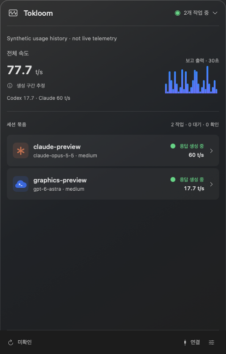
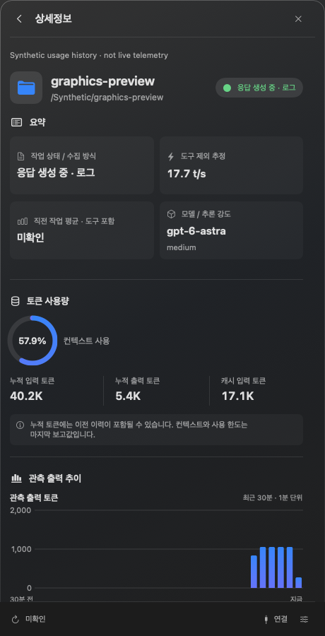
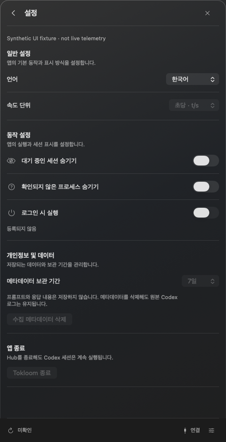

<p align="center"><a href="README.md">English</a> · <strong>한국어</strong></p>

<div align="center">
  
  <h1>Tokloom</h1>
  <p><strong>Codex와 Claude Code 작업의 흐름을 메뉴바에서.</strong></p>
  <p>지금 어떤 작업이 진행 중인지, 얼마나 출력했는지,<br />사용 한도가 얼마나 남았는지 한눈에 확인하세요.</p>
  <p><sub>macOS 14+ · Apple Silicon · SwiftUI + AppKit · 한국어 / English</sub></p>
  <p>
    <a href="https://github.com/codexstatusbar/codexstatusbar/releases">다운로드</a> ·
    <a href="#앱-화면">화면 둘러보기</a> ·
    <a href="#빌드와-실행">직접 빌드</a> ·
    <a href="#속도-계산과-표시">측정 방식</a>
  </p>
</div>

---

Tokloom은 Codex 또는 Claude Code를 사용하는 개발자를 위한 네이티브 메뉴바 모니터입니다. 기존 터미널을 그대로 사용하면서, 두 도구의 실행 중인 프로세스의 활동 상태·출력 속도·토큰 사용량을 한곳에서 확인할 수 있습니다.

- **Codex와 Claude Code를 함께** — 실행 중인 Claude Code 세션이 Codex 세션 옆에 각자의 아이콘으로 표시되고, 속도는 하나의 통합 숫자로 합산됩니다([Claude Code 세션](#claude-code-세션) 참고).
- **작업 흐름 확인** — 메뉴바의 `t/s`·`t/m`, 프로세스별 작업·대기 상태와 개별 속도.
- **사용 한도 확인** — Codex와 Claude의 5시간 세션·주간 남은 사용량을 메뉴바와 개요의 제공자별 열에 리셋까지 남은 시간과 함께 표시합니다([계정 사용 한도](#계정-사용-한도) 참고).
- **60분 출력 기록** — 앱 재시작 후에도 복원되는 출력 차트(세션별은 최근 30초 또는 30분, 통합 차트는 60초 또는 60분).
- **세션 상세정보** — 모델·추론 강도, 컨텍스트 사용률, 입력·출력 토큰과 남은 사용 한도.
- **macOS에 맞춘 화면** — 460pt 팝오버, 반투명 글래스 스타일, 다크·라이트 모드와 언어 설정.

> 기본 속도는 **도구 실행·대기를 제외한 추정치**입니다. 서버의 순수 토큰 생성 속도를 의미하지 않습니다.

## 앱 화면

<table>
  <tr>
    <td width="50%" align="center" valign="top">
      <h3>01 · 작업 한눈에 보기</h3>
      <p>Codex와 Claude를 합친 전체 속도, 실행 중인 세션,<br />최근 60초 또는 60분의 관측 출력량.</p>
      <a href="docs/images/overview.png"></a>
    </td>
    <td width="50%" align="center" valign="top">
      <h3>02 · 세션 깊이 살펴보기</h3>
      <p>모델과 추론 강도, 컨텍스트 사용률,<br />토큰 집계와 출력 추이.</p>
      <a href="docs/images/details.png"></a>
    </td>
  </tr>
  <tr>
    <td colspan="2" align="center" valign="top">
      <h3>03 · 연결과 설정</h3>
      <p>Codex·Claude Code 로그 경로, 언어, 속도 표시, 상태바 항목,<br />실행 동작과 메타데이터 보관 기간을 한곳에서.</p>
      <a href="docs/images/settings.png"></a>
    </td>
  </tr>
</table>

<sub>현재 앱 UI를 샘플 데이터로 렌더링한 예시입니다. 실제 계정·프로젝트 정보나 성능 벤치마크가 아니며, 일부 동작 버튼은 샘플 상태에서 비활성화돼 있습니다. 이미지를 누르면 원본 크기로 볼 수 있습니다.</sub>

[Releases](https://github.com/codexstatusbar/codexstatusbar/releases)에서 DMG를 받아 연 다음 **Tokloom.app**을 **Applications**로 드래그하세요. 릴리스 파일은 DMG이며, Actions 아티팩트 다운로드는 GitHub가 별도 ZIP으로 감쌀 수 있습니다.

## 빌드와 실행

macOS 14+ 대상이며, 빌드에는 Swift 6.4 Command Line Tools가 필요합니다. Xcode 프로젝트는 사용하지 않습니다.

```sh
./scripts/build-app.sh
open '.build/Tokloom.app'
# 개발용 Tokloom Debug 빌드와 실행
./scripts/run-app.sh
```

`build-app.sh`의 기본값과 `package-app.sh`는 Release이며 `Tokloom.app`을 생성합니다. 개발용은 `./scripts/build-app.sh debug` 또는 `./scripts/run-app.sh`로 만들며 이름과 창 제목이 `Tokloom Debug`인 별도 번들을 생성합니다. 기존 설정과 관측 기록은 공유합니다.

배포 번들은 arm64 release이며 로컬 ad-hoc 서명을 사용합니다. 배포 서명·공증은 되어 있지 않습니다. 첫 SwiftPM 빌드는 고정된 테스트 의존성을 내려받을 수 있습니다.

**설정 → 로그 연결**에서 Codex 홈을 선택하세요. 실행 중인 Codex 터미널이 가장 많이 쓰는 홈(`CODEX_HOME`이 없는 프로세스는 `~/.codex`)으로 시작하고, 실행 중인 것이 없으면 `~/.codex`를 씁니다. Tokloom을 실행한 셸의 `CODEX_HOME`은 무시하며, 다른 홈이 필요하면 여기서 선택하세요. 선택은 저장됩니다. 기존 Codex를 재시작할 필요 없이 원본 로그를 읽기 전용으로 관측합니다. 로그 수집 주기는 1초입니다.

목록에는 현재 살아 있는 프로세스만 표시하며, PID·시작 시각과 정확한 로그 파일 ID로 세션을 연결합니다. 아직 세션을 식별하지 못한 프로세스는 확인 중으로 표시하고, 종료된 프로세스의 과거 이력은 목록에 넣지 않습니다. 앱 종료는 Codex 세션을 종료하지 않습니다.

## GitHub Actions 번들

[macOS bundle](.github/workflows/bundle.yml)은 `*.*.*` 패턴의 태그를 push할 때만 동작합니다(예: `1.2.3`). 브랜치 push·PR·수동 실행에서는 시작하지 않습니다. GitHub의 Xcode 27 arm64 프리뷰 러너(`xcode-27`)와 Xcode 27.0을 사용합니다. 러너 제공 범위는 [GitHub runner images](https://github.com/actions/runner-images#available-images)를 참고하세요.

1. `test`: Core/Collector 자동 테스트.
2. `verify`: 기존 합성 UI·격리된 프로세스 검증과 화면 증거 수집.
3. `bundle`: 두 검증이 성공하면 arm64 앱을 빌드하고 서명·리소스를 확인한 뒤 DMG 생성.

[Releases](https://github.com/codexstatusbar/codexstatusbar/releases)에서 `Tokloom-macos-arm64.dmg`와 SHA-256 파일을 받으세요. 앱 번들에는 앱과 아이콘만 들어 있습니다. 릴리스 태그가 곧 버전입니다. 태그 `X.Y.Z`를 푸시하면 앱 버전 `X.Y.Z`, 빌드 번호 `X·1,000,000 + Y·1,000 + Z`로 빌드되므로 릴리스에 별도 커밋이 필요 없습니다. 저장소의 `Info.plist`에는 자리표시자 `0.0.0`이 들어 있고, 로컬 빌드에 버전을 주려면 `TOKLOOM_VERSION=X.Y.Z`를 지정하세요.

릴리스 게시가 성공하고 두 파일의 업로드를 확인하면 `cleanup`이 해당 실행의 Actions 아티팩트(DMG 사본·검증 이미지·업로드한 로그 파일)를 삭제합니다. 릴리스 파일, 워크플로 실행 로그와 빌드 캐시는 유지합니다. 실패한 실행의 아티팩트는 최대 14일 보관합니다.

릴리스 노트에는 이전 조상 버전 태그 이후 모든 커밋의 제목·링크와 전체 비교 링크가 포함됩니다. 같은 태그를 재실행하면 파일과 노트가 함께 갱신됩니다. 태그를 로컬에 생성한 것만으로는 실행되지 않으며 GitHub에 push해야 합니다.

별도의 [Warm Swift caches 워크플로](.github/workflows/cache.yml)가 관련 `main` 변경에서 실행되어 태그가 읽을 수 있는 캐시를 준비합니다. Debug·Release·UI 컴파일 캐시를 Swift/SDK·아키텍처·의존성 잠금 파일·커밋별로 구분하고, 태그 빌드는 호환되는 main 캐시를 재사용합니다. 커밋·도구 체인까지 정확히 일치할 때만 컴파일 결과를 그대로 쓰고, 이전 커밋의 호환 캐시에서는 다시 컴파일합니다. 테스트 실행·패키징·서명/리소스 검증은 항상 수행합니다. UI 실행 파일은 소스·도구 체인 지문이 같을 때만 재사용하며 실제 검증은 매번 실행합니다. 완성된 앱·DMG·스크린샷·사용자 데이터는 캐시에 넣지 않습니다. 첫 실행이나 도구 체인 변경 시에는 캐시가 없을 수 있습니다.

로컬에서도 같은 번들을 만들 수 있습니다.

```sh
./scripts/package-app.sh
(cd .build/dist && shasum -a 256 -c Tokloom-macos-arm64.dmg.sha256)
```

결과는 `.build/dist/`에 생성됩니다. 로컬 ad-hoc 서명이며 Apple 배포 서명·공증을
추가하는 작업은 아닙니다. CI의 합성 검증도 실제 provider·전체 네이티브 QA를
대신하지 않습니다.

## 속도 계산과 표시

추정 방식은 하나입니다. 설정에서는 표시 단위만 선택합니다.

| 표시하는 값 | 계산 방식 | 한계 |
| --- | --- | --- |
| 생성 구간 추정 | 보고된 출력 토큰을 응답이 생성된 구간(도구 실행·대기 제외)으로 나눈 값 | 새 사용량 로그가 들어올 때 갱신합니다. 작업 중과 대기 전환 후 10초 동안 유지하며, 이후에는 `—`로 표시하고 합계에서도 제외합니다. |

Codex는 Codex 자체 추적 로그(`logs_2.sqlite`, 읽기 전용)에 기록된 응답 헤더 수신 시각부터 구간을 잡아, 첫 응답을 기다린 시간은 계산에 넣지 않습니다. 해당 기록이 없으면 직전 사용량 보고 이후의 시간으로 되돌아갑니다. Claude Code는 마지막 사용자·도구 결과 항목부터 구간을 잡습니다. 두 소스 모두 첫 토큰 시각을 기록하지 않으므로 숨겨진 추론 지연은 일부 남을 수 있습니다.

`t/s`는 초당 토큰, `t/m`은 분당 토큰입니다. 분 단위 표시는 같은 속도의 60배이며 계산 구간을 1분으로 바꾸는 설정이 아닙니다. 워밍업·수집 공백·지원하지 않는 소스에서는 임의로 0을 만들지 않고 `—`를 표시합니다.

메뉴바와 메인 합계는 같은 모드의 관측된 CLI root 중 독립 범위가 확인된 항목만 합산합니다. 같은 스레드의 direct/log는 하나의 권위만 사용합니다. 모든 자식·하위 에이전트 사용량을 포함하는 계정 전체 합계가 아니며, 범위와 제외 이유는 상세정보에서 확인합니다.

## 세션 묶음

부모 관계가 로그로 확인된 보조 세션은 메인에서 본 세션과 한 행으로 묶고 보조 개수를 표시합니다. 상세정보에는 보조 세션을 한 행에 두 개씩 배치하는 2열 그리드가 있으며, 각 칸에 상태·속도·최근 30분 출력 차트를 표시하며, 차트를 누르면 해당 세션 상세정보로 이동합니다. 본 세션이 대기 중이어도 보조 세션이 작업 중이면 묶음은 표시됩니다. 메인 행의 숫자는 본 세션 자신의 속도이며, 상속된 부모·자식 누적값은 임의로 합산하지 않습니다. 프로젝트명이나 PID가 같다는 이유만으로 묶지 않고, 부모가 없거나 모호하거나 순환하는 관계는 따로 남깁니다. 로그에는 세션이 시작한 모든 보조 세션이 남으므로, 작업 중이 아니고 마지막으로 본 지 10분이 넘은 보조 세션은 목록과 개수에서 제외합니다. 작업 중이거나 마지막 활동 시각을 알 수 없는 세션은 그대로 둡니다.

## 프로세스별 표시

작업 중인 프로세스는 대기 중인 항목보다 위에 표시됩니다. 상세정보에서 다음을 확인할 수 있습니다.

- 모델·추론 강도, 작업 상태와 수집 방식, PID와 작업 경로.
- 컨텍스트 사용률: 마지막 보고의 `last_token_usage.total_tokens / model_context_window`.
- K/M/G 단위의 누적 입력·출력·캐시 토큰. 누적값에는 상속한 이전 이력이 포함될 수 있습니다.
- **남은 사용 한도**: `100 - used_percent`와 갱신까지 남은 시간. 예를 들어 사용률이 43%이면 `57% 남음 · 6d 19h`로 표시합니다. 시간은 `resets_at`에서 계산하며 한도 창의 길이를 남은 시간으로 사용하지 않습니다.
- 보고된 요청 티어와 Codex 홈의 기본 속도 설정. Fast/Ultrafast와 기본 설정을 구분하며, `priority`와 `fast`는 Fast로 표시합니다.

사용 한도는 각 세션의 마지막 보고값이며 이 세션별 한도를 합산하지 않습니다. 계정 단위 한도는 [계정 사용 한도](#계정-사용-한도)를 참고하세요. 갱신 시각이 없으면 미확인, 이미 지났으면 갱신 대기로 표시합니다. 새 보고 없이 한도가 복구됐다고 가정하지 않습니다.

프로필·CLI override와 실제 서버 응답 티어는 기본 설정과 다를 수 있습니다. 기록이 없으면 활성 여부는 미확인으로 남깁니다. 홈 설정의 단순 root-level `service_tier`만 읽으며 설정 파일을 변경하지 않습니다.

## 차트와 로컬 저장

메인과 상세정보의 차트는 **새로 관측한 출력 토큰 증가분**을 표시합니다. `t/s`에서는 막대 하나가 1초이고 최근 30초(통합 개요 차트는 60초)를, `t/m`에서는 막대 하나가 매분 00초에서 시작하는 1분이고 최근 30분(통합 개요 차트는 60분)을 보여 줍니다. 새 기록이 없으면 기존 막대의 합계는 유지되고 표시 구간만 막대 하나씩 이동합니다. 속도 그래프가 아니라 출력량 그래프이며, 단위는 막대 크기와 범위만 바꾸고 기록은 항상 60분을 보관합니다. 개요에는 제공자별 사용 한도 옆에 제공자별 차트도 표시합니다.

관측값은 보호된 SQLite 메타데이터 DB에 저장합니다. 재시작·재부팅 후에는 저장 시각을 기준으로 최근 60분 기록을 복원합니다. 실시간 누적 카운터의 기준점은 복원하지 않으므로 앱이 꺼져 있던 동안의 증가분을 새 관측값으로 추가하지 않습니다. 메인 차트는 현재 연결된 독립 CLI root 범위만 표시하며 수집 오류 중에는 숨깁니다.

설정에서 수집 메타데이터를 삭제하면 차트도 삭제됩니다. 원본 Codex 로그는 유지됩니다. 이전 버전의 저장 오류로 비어 있거나 저장되지 않은 차트는 복원할 수 없습니다.

## 설정

**설정**에는 언어, 표시 단위, 상태바 표시 항목(속도: 통합·제공자별·둘 다·숨김, 남은 사용량: Codex·Claude·둘 다·숨김, 5시간·주간·둘 다, 선택적으로 리셋까지 남은 시간), 대기 세션 숨기기, 로그인 시 실행, 메타데이터 보관 기간과 삭제, 앱 종료가 있습니다. 로그인 시 실행은 사용자가 토글할 때만 변경합니다. 수집 진단 아래의 **로그 연결**에는 Codex 홈 선택·복사, 즉시 확인, Claude Code 홈과 Claude Code 로그인 확인 여부, 있을 때의 수집 진단가 있습니다.

경로는 각각의 복사 버튼으로 복사합니다.

macOS 26 이상에서는 지원되는 버튼에 네이티브 Glass 스타일을 사용합니다. 이전 macOS에서는 기본 테두리 버튼을 사용하며, ‘투명도 줄이기’를 켜면 불투명 시스템 배경을 사용합니다. 메뉴바 우클릭 메뉴에서 앱 열기·종료를 선택할 수 있습니다.

### 제거됨: Codex 훅

이전 버전은 선택적 Codex 훅을 설치할 수 있었습니다. 지금은 제거되었고, Tokloom은 로그만 읽으며 `hooks.json`을 건드리지 않습니다. 이미 설치했다면 `CODEX_HOME/hooks.json`에서 명령 경로에 `CodexHub/hooks`가 들어 있는 항목을 직접 삭제하세요.

## Claude Code 세션

실행 중인 Claude Code CLI 세션이 `CLAUDE_CONFIG_DIR` 또는 `~/.claude`에서 읽기 전용으로 Codex 세션과 함께 표시됩니다. `sessions/<pid>.json`이 살아 있는 프로세스(PID와 시작 시각)와 일치할 때만 나타나고, 사용량은 `projects/` 아래 대화 기록에서 읽습니다. 아무것도 수정하지 않으며 프롬프트나 응답 본문은 저장하지 않습니다.

- **같은 측정 방식** — 메시지별 `output_tokens`(생각 토큰 포함)를 마지막 user/tool_result 항목부터 그 메시지의 마지막 블록까지의 시간으로 나눕니다. 도구 실행은 그 항목들 사이에 있으므로 Codex처럼 제외됩니다. 서버 대기와 prefill 시간은 남아 있습니다.
- **하나의 통합 속도** — 메뉴바와 개요는 Codex와 Claude의 관측된 CLI 루트를 합산합니다. 둘 다 있으면 개요에 제공자별 열로 각자의 속도와 차트를 표시합니다.
- 스트림으로 반복 기록된 블록은 `message.id`당 한 번만 셉니다. 입력은 캐시 읽기/쓰기를 포함해 Codex와 같은 의미로 맞춥니다.
- **컨텍스트 사용률** — 가장 최근 요청의 입력(입력 + 캐시 읽기·쓰기, Claude Code 자체 게이지와 같은 기준)을 모델의 창 크기로 나눕니다. 창 크기는 Claude Code가 로컬에 저장하는 모델 카탈로그(`~/.claude/cache/model-catalog/*.json`의 모델별 `max_input_tokens`)에서 읽어서 새 모델이나 200k/1M 구분을 따라갑니다. 모델 이름으로 창 크기를 추측하지 않으므로, 카탈로그에 없는 모델이나 카탈로그가 없는 Claude Code에서는 퍼센트를 표시하지 않습니다. 서브에이전트도 각자 표시합니다.
- **Claude 세션별로 제공하지 않는 항목**: 그 세션의 남은 사용 한도(계정 한도는 아래에서 따로 표시합니다).
- **서브에이전트** — Claude Code는 각 서브에이전트의 대화 기록을 별도 파일(`<세션>/subagents/agent-*.jsonl`, 끝난 시점을 알려 주는 `.meta.json` 포함)에 씁니다. 세션은 서브에이전트와 합산됩니다. 상세 화면은 합산한 토큰·속도·출력 차트를 보여 주고(서브에이전트는 자기 토큰만 쓰므로 이중으로 세지 않습니다), *세션* 영역에 메인 세션과 서브에이전트마다 모델·속도·차트가 있는 카드를 나열합니다. 개요의 통합 속도, 통합·제공자별 차트, 상태바에도 서브에이전트가 포함됩니다. 서브에이전트의 토큰은 목록에서 빠진 뒤(끝난 지 10분 뒤)에도 세션 합계에 남습니다. 서브에이전트가 없는 세션은 자기 자신만 표시합니다. Codex 하위 세션은 부모의 카운터를 물려받으므로 카드는 따로 두되 합산하지 않습니다.
- CLI 세션만 통합 속도에 포함됩니다.
- 수집은 Codex 홈이 연결된 뒤에 시작됩니다. Claude 세션의 최근 60분 차트 기록은 Codex 기록과 함께 저장·복원됩니다.

## 계정 사용 한도

개요는 제공자별로 열을 나누어 보여 주고, 상태바에는 같은 값을 `S`(5시간 세션)와 `W`(주간)로 남은 비율과 함께 표시할 수 있습니다. 상태바에서는 제공자 아이콘 옆에 두 창을 `S`가 위, `W`가 아래인 두 줄로 쌓아 보여 주며, 창이 하나뿐인 제공자는 한 줄로 표시합니다. 5분마다 갱신합니다.

- **Codex** — 로컬 세션 로그(`~/.codex/sessions`)에서 가장 최근 `rate_limits`를 읽으며, `auth.json`이 있을 때만 표시합니다. 이미 리셋된 창은 숨깁니다.
- **Claude** — Claude Code는 한도를 로그에 남기지 않으므로, Claude Code가 macOS 키체인(`Claude Code-credentials`)에 저장한 OAuth 토큰으로 Anthropic 사용량 엔드포인트(`api.anthropic.com/api/oauth/usage`)를 조회합니다. 토큰은 `/usr/bin/security`로 읽어 해당 엔드포인트에만 보내며 저장하거나 기록하지 않습니다. macOS가 키체인 접근 허용을 한 번 물을 수 있습니다. Claude Code 로그인이 없거나 토큰이 만료되었으면 표시하지 않습니다.
- 창 이름은 데이터의 길이를 따릅니다. 세션은 `5h`, 주간은 10080분입니다. 제공자가 보고하지 않는 창은 빼고, 해당 칸은 비워 두어 주간 막대 위치가 유지됩니다.
- **크레딧** — 창을 모두 쓰면 요금제가 크레딧을 소비하며, 개요의 제공자 막대 아래에 남은 양을 표시합니다. Codex 잔액은 같은 로그 보고의 `rate_limits.credits`에서 읽고(창이 이미 리셋된 뒤에도 가장 최근 보고가 기준이며, 무제한 계정은 무제한으로 표시), Claude는 사용량 응답의 `spend`(선불 잔액, 또는 지출 한도에서 사용한 양을 뺀 값)나 옛 응답의 `extra_usage`에서 읽습니다. Claude는 계정에 사용량 크레딧이 켜져 있을 때만 값이 있고, 켜져 있지 않으면 크레딧 줄을 표시하지 않습니다.

## 현재 범위

기존 설치의 설정·관측 기록을 유지하기 위해 앱 번들 식별자와 `CodexHub` 저장 경로, 내부 모듈 이름은 그대로 사용합니다. 앱 표시 이름과 배포 파일명은 Tokloom입니다.

## 구조와 저장

| 모듈 | 역할 |
| --- | --- |
| `CodexHubCore` | 상태·누적 사용량·작업/관측 구간 평균 |
| `CodexHubCollector` | 읽기 전용 로그/관리형 메타데이터 수집과 SQLite 체크포인트 |
| `CodexHubApp` | SwiftUI 화면, AppKit 메뉴바, 사용자 설정과 차트 저장 |

프로덕션 구현은 Swift와 macOS 시스템 라이브러리를 사용합니다. Tokloom은 프롬프트·응답 원문을 저장하지 않습니다. 메타데이터는 `~/Library/Application Support/CodexHub/homes/<homeHash>`. 이전 버전이 남긴 `managed-runs` 폴더는 더 이상 읽지 않으며 삭제해도 됩니다.

삭제·보관 정책은 Tokloom 메타데이터에만 적용하며 원본 Codex 로그는 수정하지 않습니다.

## 검증 상태와 문서

최근 완료한 범위는 Core/Collector 테스트 103개, UI·P 항목의 합성 UI/프로세스 검증 126개, arm64 앱 빌드입니다. 검증 시점과 조건은 아래 기록을 참고하세요. 합성 렌더링과 코드 테스트가 실제 메뉴바 조작이나 서버 연동 전체 검증을 대신하지는 않습니다.

전체 PRD의 출시 완료 상태는 아닙니다. TUI·승인·G0, VoiceOver, 장시간 실행, macOS 14 실기기와 전체 provider 실행 경로는 검증이 남아 있습니다.

- [초기 설계 PRD (보관; 현재 제품은 로그 수집과 Claude Code 지원으로 구현됨)](docs/Codex_Hub_PRD.md)
- [네이티브 UI와 회귀 검증](docs/verification/native-ui.md)
- [수집기 검증](docs/verification/collector.md)
- [수집 입력 계약](docs/collector-inputs.md)
