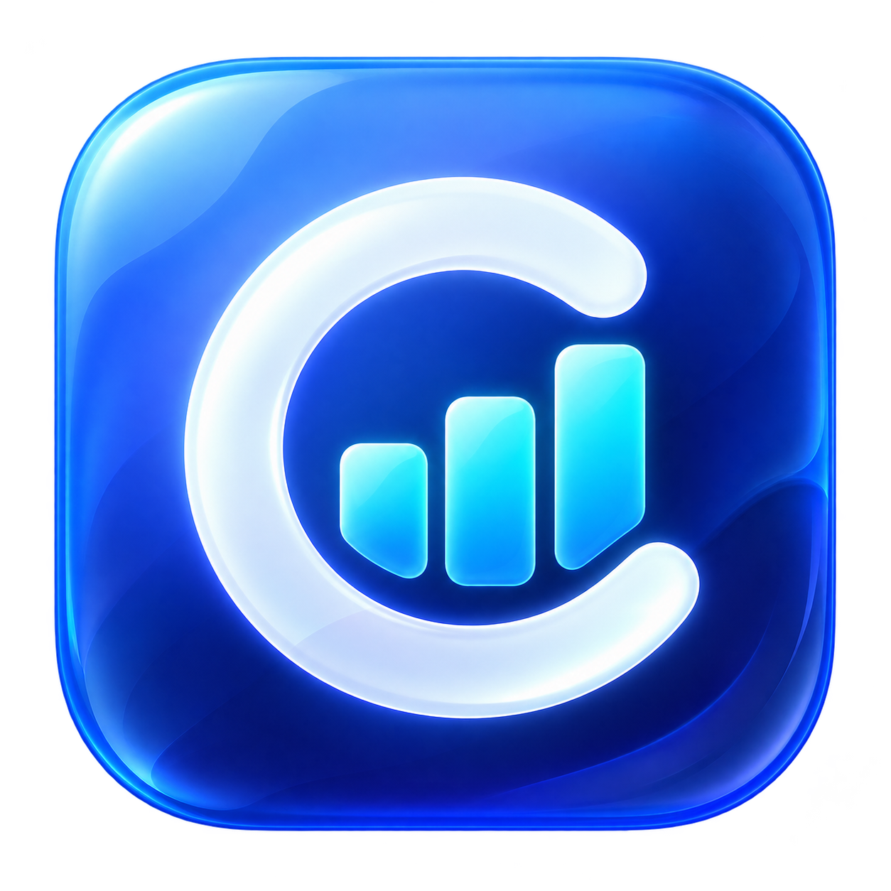
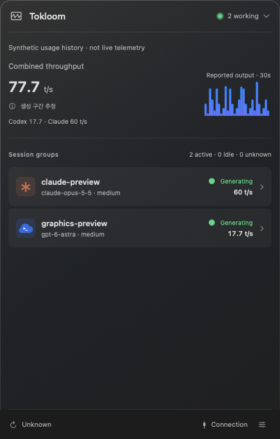
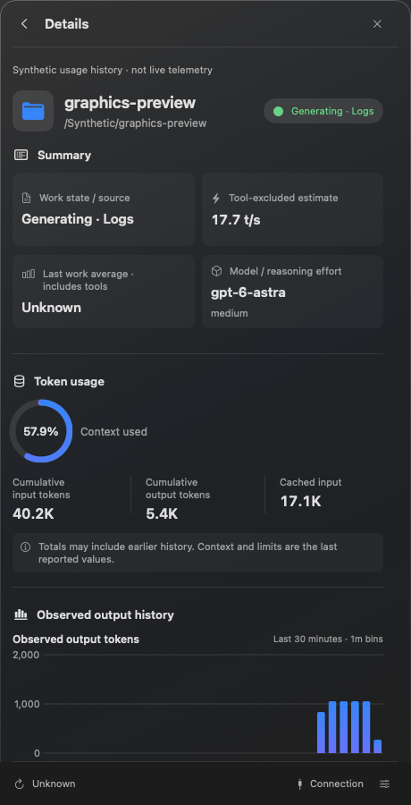
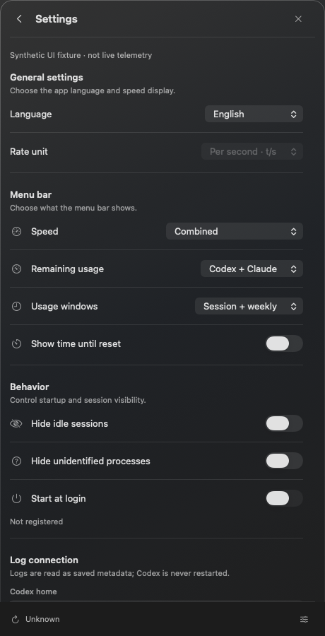

<p align="center"><strong>English</strong> · <a href="README.ko.md">한국어</a></p>

<div align="center">
  
  <h1>Tokloom</h1>
  <p><strong>Your Codex and Claude Code workflow, at a glance.</strong></p>
  <p>See what's running, how much it has generated,<br />and how much of your usage allowance remains—all from the menu bar.</p>
  <p><sub>macOS 14+ · Apple Silicon · SwiftUI + AppKit · English / 한국어</sub></p>
  <p>
    <a href="https://github.com/codexstatusbar/codexstatusbar/releases">Download</a> ·
    <a href="#screenshots">Explore the app</a> ·
    <a href="#build-and-run">Build from source</a> ·
    <a href="#speed-estimate">How measurements work</a>
  </p>
</div>

---

Tokloom is a native menu bar monitor for developers using Codex or Claude Code. Keep your existing terminal and track running processes, output speed, and token usage for both tools in one place.

- **Codex and Claude Code together** — running Claude Code sessions appear beside Codex ones, each marked with its own icon, and their speeds add up to one combined number (see [Claude Code sessions](#claude-code-sessions)).
- **Follow your work** — menu bar `t/s` or `t/m`, per-process speed, and working/idle states.
- **See your limits** — the 5-hour session and weekly remaining usage of Codex and Claude, in the menu bar and in a column per provider on the overview, with time until reset (see [Account usage limits](#account-usage-limits)).
- **Keep 60 minutes of history** — output charts (the last 30 seconds or minutes per session, 60 for the combined chart) that survive app restarts.
- **Inspect each session** — model, reasoning effort, context utilization, input/output tokens, and remaining usage allowance.
- **Feel at home on macOS** — a compact 460pt popover, translucent glass styling, light/dark appearances, and language settings.

> The default speed is an **estimate excluding tool execution and waiting time**. It is not the server's pure token generation speed.

## Screenshots

<table>
  <tr>
    <td width="50%" align="center" valign="top">
      <h3>01 · Work at a glance</h3>
      <p>Combined Codex and Claude speed, active sessions,<br />and observed output over the last 60 seconds or minutes.</p>
      <a href="docs/images/overview-en.png"></a>
    </td>
    <td width="50%" align="center" valign="top">
      <h3>02 · Inside each session</h3>
      <p>Model and reasoning effort, context usage,<br />token totals and output history.</p>
      <a href="docs/images/details-en.png"></a>
    </td>
  </tr>
  <tr>
    <td colspan="2" align="center" valign="top">
      <h3>03 · Connection and settings</h3>
      <p>The Codex and Claude Code log paths, language, speed display, menu bar items,<br />startup behavior and metadata retention, in one place.</p>
      <a href="docs/images/settings-en.png"></a>
    </td>
  </tr>
</table>

<sub>These are renders of the current app UI with synthetic data, not real account/project information or performance benchmarks. Some action buttons are disabled in the sample state. Click an image to view it at full size.</sub>

Download the DMG from [Releases](https://github.com/codexstatusbar/codexstatusbar/releases), open it, and drag **Tokloom.app** to **Applications**. Release assets are DMG files; GitHub may wrap Actions artifacts in a separate ZIP for download.

## Build and run

Targets macOS 14+. Building requires Swift 6.4 Command Line Tools. No Xcode project is required.

```sh
./scripts/build-app.sh
open '.build/Tokloom.app'
# Build and launch the development app, Tokloom Debug
./scripts/run-app.sh
```

`build-app.sh` defaults to Release, and `package-app.sh` explicitly uses Release; both produce `Tokloom.app`. Use `./scripts/build-app.sh debug` or `./scripts/run-app.sh` for a separate bundle named **Tokloom Debug**, also shown in its window title. Settings and observation history are shared.

Distribution bundles are arm64 Release builds with local ad-hoc signatures. They are not signed with an Apple distribution certificate or notarized. The first SwiftPM build may download pinned test dependencies.

Choose your Codex home in **Settings → Log connection**. Tokloom starts with the home that most running Codex terminals use (a process without `CODEX_HOME` uses `~/.codex`), or `~/.codex` when none runs. The `CODEX_HOME` of the shell that launched Tokloom is ignored; choose another home here if you need one, and your choice is kept. Tokloom reads original logs without modifying them or restarting Codex, polling once per second.

Only live processes appear in the list. Sessions are matched using PID, process start time, and exact log file identity. Unmatched processes remain in an identifying state; exited processes are not listed as historical sessions. Quitting Tokloom does not stop Codex sessions.

## GitHub Actions bundles

The [macOS bundle workflow](.github/workflows/bundle.yml) runs only when a tag matching `*.*.*` is pushed, such as `1.2.3`. Branch pushes, pull requests, and manual dispatch do not trigger it. It uses GitHub's Xcode 27 arm64 preview runner (`xcode-27`) with Xcode 27.0. See [GitHub runner images](https://github.com/actions/runner-images#available-images) for availability.

1. `test`: Core/Collector automated tests.
2. `verify`: synthetic UI and isolated process checks, with rendered evidence.
3. `bundle`: after both checks pass, build the arm64 app, validate signatures/resources, and create a DMG.

Download `Tokloom-macos-arm64.dmg` and its SHA-256 file from [Releases](https://github.com/codexstatusbar/codexstatusbar/releases). The app bundle contains only the app and its icon.

After publication succeeds and both release assets are confirmed, `cleanup` deletes that run's Actions artifacts (bundle copies, rendered evidence and uploaded log files). Release assets, workflow run logs and build caches are retained. Artifacts from failed runs remain available for up to 14 days.

Release notes include every commit since the previous ancestor version tag and a full comparison link. Rerunning the same tag updates its assets and notes. Creating a local tag alone does not trigger a release; push it to GitHub.

A separate [Warm Swift caches workflow](.github/workflows/cache.yml) runs on relevant `main` changes to seed caches accessible to version tags. Debug, Release and UI compiler caches are separated by compiler/SDK, architecture, dependency lockfile and commit. Tag builds can fall back to compatible main-branch caches. An exact source-commit/toolchain cache hit reuses compiled products; prefix-only matches still compile. Tests, packaging and signature/resource checks always run. UI binaries are reused only when their source/toolchain fingerprint matches; all checks still execute every time. Final apps, DMGs, screenshots and user data are not cached. The first build or a changed toolchain can still be cold.

The same packaging path is available locally:

```sh
./scripts/package-app.sh
(cd .build/dist && shasum -a 256 -c Tokloom-macos-arm64.dmg.sha256)
```

Output goes to `.build/dist/`. Packaging uses ad-hoc signing, not Apple distribution signing or notarization. Synthetic CI checks do not replace provider or full native QA.

## Speed estimate

There is a single estimate. Choose the display unit in Settings.

| What it shows | How it is measured | Limits |
| --- | --- | --- |
| Generation-interval estimate | Reported output tokens divided by the interval in which the response was generated, excluding tool execution/waiting | Updates on new usage reports. Holds while working and for 10 seconds after becoming idle; then the row shows `—` and leaves the aggregate. |

For Codex, the interval starts when the response headers arrive, read from Codex's own tracing log (`logs_2.sqlite`, opened read-only); time spent waiting for the first response is not counted. If that log has no matching entry, the interval falls back to the time since the previous usage report. Claude Code intervals start at the last user or tool-result entry. Neither source records the first token itself, so hidden reasoning latency can remain included.

`t/s` means tokens per second; `t/m` means tokens per minute. The minute display multiplies the same rate by 60—it does not change the measurement interval to one minute. Warm-up, observation gaps, and unsupported sources show `—`, never a fabricated zero.

The menu bar and overview sum only observed CLI roots with verified independent scope, using this one estimate. Direct and log observations for the same thread have a single authority. This is not an account-wide total including every child/subagent. Details explains scope and exclusions.

## Session groups

Explicitly linked auxiliary sessions share one overview row with their main session, marked with an auxiliary count. Details lays out auxiliary sessions in a two-column grid, keeping each child's state, speed and 30-minute output chart separate, with each chart opening its full details when clicked. An active child keeps its group visible even when the parent is idle. The main row's numeric speed remains the main session's own rate; inherited parent/child counters are not blindly added. Same project names or PIDs alone never establish parentage. Missing, ambiguous or cyclic parent links remain separate.

## Per-process information

Working processes appear above idle ones. Details includes:

- Model, reasoning effort, activity, collection source, PID, and working directory.
- Context utilization: the last reported `last_token_usage.total_tokens / model_context_window`.
- Cumulative input, output, and cached tokens abbreviated with K/M/G. Totals may include inherited history.
- **Remaining usage allowance**: `100 - used_percent`, followed by time until reset. For example, 43% used becomes `57% left · 6d 19h`. The countdown comes from `resets_at`, not the quota window length.
- Reported request tier and the Codex home's default speed setting. Fast/Ultrafast request metadata is separate from defaults; `priority` and `fast` display as Fast.

Limits are each session's last reported values. Tokloom does not sum these per-session limits. Account-wide limits are described under [Account usage limits](#account-usage-limits). Missing reset times remain unknown; elapsed deadlines show awaiting reset. An allowance is not assumed to have refreshed without a new report.

Profiles, CLI overrides, and the server's actual response tier can differ from the default. Missing request metadata remains unknown. Only a simple root-level `service_tier` setting is read from the home configuration; Tokloom does not modify it.

## Charts and local history

Overview and Details chart **newly observed output-token increments**. With `t/s` each bar is one second and the chart shows the last 30 seconds (60 for the combined overview chart); with `t/m` each bar is one minute, starting at second `00` of the wall-clock minute, and the chart shows the last 30 minutes (60 for the combined overview chart). Without new observations, bar totals stay unchanged while the window advances one bar at a time. These are output-volume charts, not speed charts; the unit only changes the bar size and range, and 60 minutes of history is always kept. The overview also draws one chart per provider beside that provider's usage limits.

Samples are saved in a protected SQLite metadata database. On app restart or reboot, the last 60 minutes are restored using stored timestamps. Live cumulative-counter anchors are not restored, so growth while the app was closed is not added as newly observed output. The overview chart includes only currently connected independent CLI roots and is hidden during collection errors.

Clearing collected metadata also clears chart history. Original Codex logs remain intact. Empty or unsaved history from older versions affected by the persistence bug cannot be recovered.

## Settings

**Settings** provides language, display unit, what the menu bar shows (speed: combined, by provider, both or hidden; remaining usage: Codex, Claude, both or hidden; the 5-hour window, the weekly window or both; optionally the time until reset), hide-idle behavior, start at login, metadata retention/deletion, and quit. Login startup changes only when the user toggles it. **Log connection**, below the diagnostics, holds the Codex home selection and copying, an immediate check, the Claude Code home with whether a Claude Code login was found, and collection diagnostics when there are any.

Paths have individual copy buttons.

On macOS 26+, supported buttons use native Glass styling. Older systems use bordered controls; Reduce Transparency uses an opaque system background. Right-click the menu bar item to open or quit the app.

### Removed: Codex hooks

Earlier versions could install optional Codex hooks. They are gone: Tokloom reads only logs and never touches `hooks.json`. If you installed them, delete the entries whose command path contains `CodexHub/hooks` from `CODEX_HOME/hooks.json`.

## Claude Code sessions

Running Claude Code CLI sessions appear beside Codex sessions, read-only, from `CLAUDE_CONFIG_DIR` or `~/.claude`. A session is listed only while its `sessions/<pid>.json` matches a live process (PID and start time); the transcript under `projects/` supplies usage. Nothing is modified and no prompt or response text is stored.

- **Same measurement** — each message's `output_tokens` (including thinking) divided by the time from the last user/tool-result entry to the message's last block. Tool execution falls between those entries, so it is excluded, as for Codex. Server queue and prefill time remain included.
- **One combined speed** — the menu bar and overview sum observed CLI roots across Codex and Claude. When both are present, the overview shows a column per provider with its own speed and chart.
- Repeated stream blocks are counted once per `message.id`; input includes cache reads and writes so it matches Codex's meaning.
- **Not available for Claude per session**: remaining usage allowance, context utilization (the window size is not logged). Subagent (sidechain) output is excluded from counters and the combined speed. Only CLI sessions count toward the combined speed.
- Collection starts only after the Codex home connects. The 60-minute chart history of Claude sessions is saved and restored with the Codex history.

## Account usage limits

The overview shows one column per provider, and the menu bar can list the same numbers as `S` (5-hour session) and `W` (weekly) with the share still unused. They refresh every five minutes.

- **Codex** — read from the newest `rate_limits` in the local session logs (`~/.codex/sessions`), only while `auth.json` exists. Windows that have already reset are hidden.
- **Claude** — Claude Code does not log its limits, so Tokloom asks Anthropic's usage endpoint (`api.anthropic.com/api/oauth/usage`) with the OAuth token Claude Code already stored in the macOS Keychain (`Claude Code-credentials`). The token is read through `/usr/bin/security`, sent only to that endpoint, and never saved or logged. macOS may ask once to allow keychain access. Without a Claude Code login, or with an expired token, nothing is shown.
- Windows are named by their length from the data: `5h` for the session and weekly for 10080 minutes. A window the provider does not report is left out and its slot stays empty so the weekly bar keeps its place.

## Current scope

The bundle identifier, `CodexHub` storage paths, and internal module names are retained for compatibility with existing settings and history. The displayed app and distribution files are named Tokloom.

## Architecture and storage

| Module | Responsibility |
| --- | --- |
| `CodexHubCore` | Activity, cumulative usage, and work/observation averages |
| `CodexHubCollector` | Read-only log collection and SQLite checkpoints |
| `CodexHubApp` | SwiftUI views, AppKit menu bar, preferences, and chart persistence |

Production code uses Swift and macOS system libraries. Tokloom does not store raw prompts or responses. Metadata lives under `~/Library/Application Support/CodexHub/homes/<homeHash>`. Leftover `managed-runs` folders from earlier versions are no longer read and can be deleted.

Deletion and retention apply to Tokloom metadata only; original Codex logs are never modified.

## Verification and documentation

Completed checks include 85 Core/Collector tests, 108 synthetic UI/process checks (UI and P labels), and arm64 app builds. See the records below for dates and conditions. Synthetic renders and code tests do not prove every native interaction or server integration.

The full PRD is not release-complete. Remaining verification includes TUI/approval/G0, VoiceOver, long-running operation, physical macOS 14 devices, and complete provider execution paths.

- [Original design PRD (archived; the product has since moved to log collection and Claude Code support)](docs/Codex_Hub_PRD.md)
- [Native UI and regression checks](docs/verification/native-ui.md)
- [Collector verification](docs/verification/collector.md)
- [Collector input contract](docs/collector-inputs.md)
