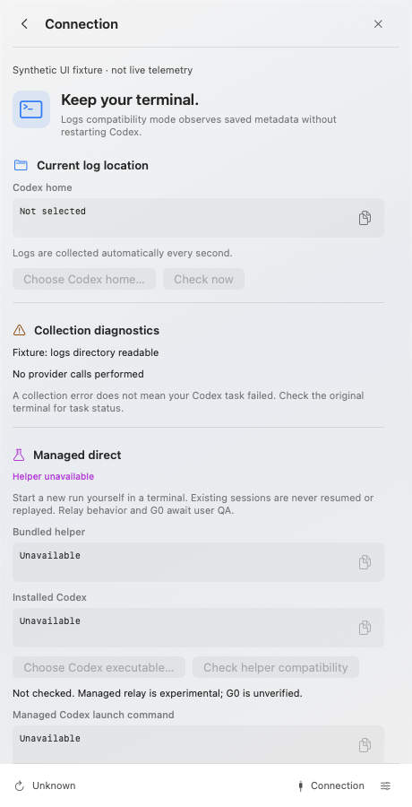

<p align="center"><strong>English</strong> · <a href="README.ko.md">한국어</a></p>

<div align="center">
  
  <h1>Tokloom</h1>
  <p><strong>Your Codex workflow, at a glance.</strong></p>
  <p>See what's running, how much it has generated,<br />and how much of your usage allowance remains—all from the menu bar.</p>
  <p><sub>macOS 14+ · Apple Silicon · SwiftUI + AppKit · English / 한국어</sub></p>
  <p>
    <a href="https://github.com/codexstatusbar/codexstatusbar/releases">Download</a> ·
    <a href="#screenshots">Explore the app</a> ·
    <a href="#build-and-run">Build from source</a> ·
    <a href="#measurement-modes">How measurements work</a>
  </p>
</div>

---

Tokloom is a native menu bar monitor for developers using Codex. Keep your existing terminal and track running processes, output speed, and token usage in one place.

- **Follow your work** — menu bar `t/s` or `t/m`, per-process speed, and working/idle states.
- **Keep 30 minutes of history** — minute-by-minute output charts that survive app restarts.
- **Inspect each session** — model, reasoning effort, context utilization, input/output tokens, and remaining usage allowance.
- **Feel at home on macOS** — a compact 460pt popover, translucent glass styling, light/dark appearances, and language settings.

> The default speed is an **estimate excluding tool execution and waiting time**. It is not the server's pure token generation speed.

## Screenshots

<table>
  <tr>
    <td width="50%" align="center" valign="top">
      <h3>01 · Work at a glance</h3>
      <p>Combined speed, active processes,<br />and observed output over the last 30 minutes.</p>
      <a href="docs/images/overview-en.png"></a>
    </td>
    <td width="50%" align="center" valign="top">
      <h3>02 · Inside each session</h3>
      <p>Model and reasoning effort, context usage,<br />token totals and output history.</p>
      <a href="docs/images/details-en.png"></a>
    </td>
  </tr>
  <tr>
    <td width="50%" align="center" valign="top">
      <h3>03 · Keep your terminal</h3>
      <p>Inspect log paths and collection diagnostics.<br />Use hooks and managed connections only when needed.</p>
      <a href="docs/images/connection-en.png"></a>
    </td>
    <td width="50%" align="center" valign="top">
      <h3>04 · Make it yours</h3>
      <p>Choose your language, speed display and startup<br />behavior, and manage metadata retention.</p>
      <a href="docs/images/settings-en.png"></a>
    </td>
  </tr>
</table>

<sub>These are renders of the current app UI with synthetic data, not real account/project information or performance benchmarks. Some action buttons are disabled in the sample state. Click an image to view it at full size.</sub>

Download the DMG from [Releases](https://github.com/codexstatusbar/codexstatusbar/releases), open it, and drag **Tokloom.app** to **Applications**. Release assets are DMG files; GitHub may wrap Actions artifacts in a separate ZIP for download.

## Build and run

Targets macOS 14+. Building requires Swift 6.4 Command Line Tools. No Xcode project is required.

```sh
./scripts/build-app.sh
open '.build/Tokloom.app'
# Build and launch the development app, Tokloom Debug
./scripts/run-app.sh
```

`build-app.sh` defaults to Release, and `package-app.sh` explicitly uses Release; both produce `Tokloom.app`. Use `./scripts/build-app.sh debug` or `./scripts/run-app.sh` for a separate bundle named **Tokloom Debug**, also shown in its window title. Settings and observation history are shared.

Distribution bundles are arm64 Release builds with local ad-hoc signatures. They are not signed with an Apple distribution certificate or notarized. The first SwiftPM build may download pinned test dependencies.

Choose your Codex home in **Connection**. The default is `CODEX_HOME` or `~/.codex`. Tokloom reads original logs without modifying them or restarting Codex, polling once per second.

Only live processes appear in the list. Sessions are matched using PID, process start time, and exact log file identity. Unmatched processes remain in an identifying state; exited processes are not listed as historical sessions. Quitting Tokloom does not stop Codex sessions.

## GitHub Actions bundles

The [macOS bundle workflow](.github/workflows/bundle.yml) runs only when a tag matching `*.*.*` is pushed, such as `1.2.3`. Branch pushes, pull requests, and manual dispatch do not trigger it. It uses GitHub's Xcode 27 arm64 preview runner (`xcode-27`) with Xcode 27.0. See [GitHub runner images](https://github.com/actions/runner-images#available-images) for availability.

1. `test`: Core/Collector automated tests.
2. `verify`: synthetic UI and isolated process checks, with rendered evidence.
3. `bundle`: after both checks pass, build the arm64 app, validate signatures/resources, and create a DMG.

Download `Tokloom-macos-arm64-<commit>` from **Actions → macOS bundle → run → Artifacts**. It contains `Tokloom-macos-arm64.dmg` and its SHA-256 file. The app includes its icon, helper, and tokenizer resources.

Artifacts and logs are retained for 14 days. After all checks and packaging succeed, the workflow creates a GitHub Release named after the tag and uploads the DMG and checksum. Rerunning the same tag replaces its release assets. Creating a local tag alone does not trigger the workflow; push it to GitHub.

The same packaging path is available locally:

```sh
./scripts/package-app.sh
(cd .build/dist && shasum -a 256 -c Tokloom-macos-arm64.dmg.sha256)
```

Output goes to `.build/dist/`. Packaging uses ad-hoc signing, not Apple distribution signing or notarization. Synthetic CI checks do not replace provider, hook-trust, or full native QA.

## Measurement modes

Choose the measurement mode and display unit in Settings.

| Mode | What it shows | Requirements and limits |
| --- | --- | --- |
| Tool-excluded estimate · default | Reported output tokens divided by an observed interval excluding tool execution/waiting | Updates when a new usage report arrives and holds until the next valid report. Some server response waiting may remain included. |
| Live visible estimate · 5s | Estimated tokens `≈` from fully observed visible response text | Requires a managed direct connection and supported model. Unavailable for ordinary log connections. |
| Server timing diagnostics | Raw server timing and output-event metadata | Does not calculate throughput. Switch to an estimate in Settings to see speed. |

`t/s` means tokens per second; `t/m` means tokens per minute. The minute display multiplies the same rate by 60—it does not change the measurement interval to one minute. Warm-up, observation gaps, and unsupported sources show `—`, never a fabricated zero.

The menu bar and overview sum only observed CLI roots with verified independent scope, using one selected mode. Direct and log observations for the same thread have a single authority. This is not an account-wide total including every child/subagent. Details explains scope and exclusions.

## Per-process information

Working processes appear above idle ones. Details includes:

- Model, reasoning effort, activity, collection source, PID, and working directory.
- Context utilization: the last reported `last_token_usage.total_tokens / model_context_window`.
- Cumulative input, output, and cached tokens abbreviated with K/M/G. Totals may include inherited history.
- **Remaining usage allowance**: `100 - used_percent`, followed by time until reset. For example, 43% used becomes `57% left · 6d 19h`. The countdown comes from `resets_at`, not the quota window length.
- Reported request tier and the Codex home's default speed setting. Fast/Ultrafast request metadata is separate from defaults; `priority` and `fast` display as Fast.

Limits are each session's last reported values. Tokloom does not sum account limits or make a separate server query. Missing reset times remain unknown; elapsed deadlines show awaiting reset. An allowance is not assumed to have refreshed without a new report.

Profiles, CLI overrides, and the server's actual response tier can differ from the default. Missing request metadata remains unknown. Only a simple root-level `service_tier` setting is read from the home configuration; Tokloom does not modify it.

## Charts and local history

Overview and Details chart **newly observed output-token increments** over the last 30 minutes. Fixed one-minute buckets start at second `00` of each wall-clock minute. Without new observations, bar totals stay unchanged; the displayed window advances once per minute. These are output-volume charts, not speed charts, and are unaffected by the `t/s`/`t/m` setting.

Samples are saved in a protected SQLite metadata database. On app restart or reboot, the last 30 minutes are restored using stored timestamps. Live cumulative-counter anchors are not restored, so growth while the app was closed is not added as newly observed output. The overview chart includes only currently connected independent CLI roots and is hidden during collection errors.

Clearing collected metadata also clears chart history. Original Codex logs remain intact. Empty or unsaved history from older versions affected by the persistence bug cannot be recovered.

## Settings and connection

**Settings** provides language, measurement mode/unit, hide-idle behavior, start at login, metadata retention/deletion, and quit. Login startup changes only when the user toggles it.

**Connection** provides log-path selection/copying, an immediate connection check, optional hooks, collection diagnostics, and experimental managed-run instructions. Hook controls appear only here. Paths and commands have individual copy buttons.

On macOS 26+, supported buttons use native Glass styling. Older systems use bordered controls; Reduce Transparency uses an opaque system background. Right-click the menu bar item to open or quit the app.

### Optional hooks

Connection's status/install/remove controls invoke the bundled helper's actual `hooks status/install/uninstall` commands. Before installation or removal, a native confirmation shows the selected `CODEX_HOME/hooks.json`, backup behavior, and manual trust requirements. Unrelated handlers are preserved; no backup is needed when there is no existing file.

Tokloom does not automatically install hooks, enable their feature, or grant trust. Review and trust the exact definitions yourself in Codex `/hooks`. Installed does not mean trusted or runtime-verified. Check status again after a failure or timeout.

Hooks provide **activity hints, not token usage**. Signals apply only when the exact session/turn matches the logs; Stop and similar signals are completion candidates.

## Experimental managed runs

Select the installed Codex executable in Connection and check helper compatibility. This is a time-bounded version check, not proof of TUI, approval, or provider compatibility. Tokloom never automatically launches Codex.

Copy the command from Connection, or adjust these paths, then run it from your intended project directory:

```sh
'/path/to/Tokloom.app/Contents/Helpers/codex-hub' doctor --codex '/absolute/path/to/codex'
env CODEX_HOME="$HOME/.codex" '/path/to/Tokloom.app/Contents/Helpers/codex-hub' run --experimental --server-timing --codex '/absolute/path/to/codex'
```

Without `--codex`, the helper searches PATH. Its currently allowed version is `codex-cli 0.163.0`. Arbitrary positional arguments, prompts, additional flags, profiles, and resume/fork are rejected. It does not attach to or restart existing runs; the app and managed run have separate lifetimes. The relay is **experimental; G0 remains unverified**.

`--server-timing` enables `runtime_metrics` and selected trace targets only for the new managed run. It does not change global settings or existing processes. Collected raw values appear in Details.

A previous real-response check received output-token counts, output-event counts, mean event intervals, and `missing_harness_boundary`, but no pure generation-duration fields. Events are not tokens, so their reciprocal interval is not converted to `t/s`. See the [server timing evidence](docs/verification/server-timing.md).

## Current scope

Live estimation tokenizes only visible response text observed completely from the start of a managed direct relay, using official `o200k_base` assets. Assets and their MIT license are bundled beside the helper as SwiftPM resources, with no runtime download.

Support requires an observed provider identifier exactly equal to `openai` and a model named `o1`, `o3`, `o4-mini`, `gpt-5`, `gpt-4.1`, or `gpt-4o`. Displaying model metadata is independent of this support list: a model can appear in the UI without supporting Live estimation. Other models/providers, missing metadata, incomplete starts, gaps, and stale observations remain unavailable. A provider identifier is not proof of the remote server's identity.

Live excludes reasoning, tool output, diffs, prompts, and past text. There is no `chars/4` fallback. Estimation stops beyond four items, 16 KiB per item, 512-byte regex segments, or the computation/work limits. Equivalence with official tiktoken has not yet been verified.

The bundle identifier, `CodexHub` storage paths, internal modules, and helper names are retained for compatibility with existing settings and history. The displayed app and distribution files are named Tokloom.

## Architecture and storage

| Module | Responsibility |
| --- | --- |
| `CodexHubCore` | Activity, cumulative usage, and work/observation averages |
| `CodexHubCollector` | Read-only log/managed-metadata collection and SQLite checkpoints |
| `CodexHubApp` | SwiftUI views, AppKit menu bar, preferences, and chart persistence |
| `CodexHubHelper` | Swift launcher and local relay |

Production code uses Swift and macOS system libraries. Tokloom does not store raw prompts or responses. Metadata lives under `~/Library/Application Support/CodexHub/homes/<homeHash>`; managed observations are separate under `managed-runs/<homeHash>` in the same `CodexHub` directory.

Deletion and retention apply to Tokloom metadata. Managed files are cleaned up only after termination, ownership, and file identity are confirmed. Running or ambiguous files and original Codex logs are preserved; deferred cleanup reasons appear in Connection diagnostics.

## Verification and documentation

Completed checks include 68 Core/Collector tests, 88 synthetic UI/process checks (UI01–UI82 and P01–P06), and arm64 app builds. See the records below for dates and conditions. Synthetic renders and code tests do not prove every native interaction or server integration.

The full PRD is not release-complete. Remaining verification includes TUI/approval/G0, VoiceOver, long-running operation, physical macOS 14 devices, Live tokenizer equivalence, and complete hook/provider execution paths. A user-installed hook is separate from automated execution/trust verification.

- [PRD](docs/Codex_Hub_PRD.md)
- [Native UI and regression checks](docs/verification/native-ui.md)
- [Collector verification](docs/verification/collector.md)
- [Server timing verification](docs/verification/server-timing.md)
- [Managed helper contract](docs/managed-helper.md)
- [Live estimator](docs/live-estimator.md) · [Optional hooks](docs/optional-hooks.md) · [Collector input contract](docs/collector-live-hooks.md)
